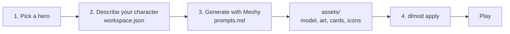

# Deadlock Modkit

Make Deadlock your own. This repository has three tools:

| Tool | What it does | Read more |
| --- | --- | --- |
| **Character kit** | Replace a hero with a character of your own: the 3D model, the hero select screen, the cards and portraits, the ability icons, the models its abilities throw, the colours of its effects and its name. Ready-made [Meshy](https://www.meshy.ai) prompts for all 44 heroes. | [Custom characters](docs/custom-characters.md), [`meshy/`](meshy/) |
| **dlmod** | A small mod manager in the terminal. It installs mods, switches them on and off, browses GameBanana with picture previews, replaces game sounds, and repairs the game's mod loading after updates. The character kit is part of it. | [dlmod](docs/dlmod.md) |
| **Counter Intelligence HUD** | An in-game panel that suggests counter items against the enemy lineup, with match data, lane counters and patch warnings. | [Counter Intelligence](docs/counter-intelligence.md) |

| dlmod | Model studio |
| --- | --- |
| [](docs/dlmod.md) | [](docs/custom-characters.md#the-model-studio) |
| [](docs/dlmod.md#browsing-mods-online) | [](docs/dlmod.md#replacing-sounds) |

## Make your own hero

Pick a hero, describe your character, generate the pieces with prompts written for that hero, and install them with one command. The hero keeps its abilities, animations and hitboxes, so it plays exactly the same; only what you see changes.



What changes in game:

| Piece | Where you see it |
| --- | --- |
| 3D model | Everywhere in a match, fitted to the hero's size and rigged to its skeleton |
| Hero select screen | The big picture, the name logo, the three tags and their colours |
| Cards and portraits | The hero grid, the scoreboard, the HUD and the minimap |
| Ability icons | The ability bar |
| Ability models | Bombs, traps and statues the abilities throw or place |
| Effects | Particles and glows, recoloured to your palette |

Try it with Haze:

```powershell
dlmod meshy haze meshy concept="Rook, a hulking stone golem with glowing blue runes"
```

Then open [`meshy/haze/prompts.md`](meshy/haze/prompts.md), generate each step in Meshy (a design sheet first, then the 3D model, the art, the cards and one icon per ability, about 150 credits in all), and save the results in `meshy/haze/assets/` under the names the prompts give. Close the game and run:

```powershell
dlmod apply meshy/haze
```

Or do it all in one page: `dlmod studio` opens the **Create** tab, which asks a few questions about your character, runs each Meshy step with a progress bar and shows the pictures as they arrive, then rigs the 3D model on the hero and installs it. See [the character creator](docs/custom-characters.md#the-character-creator). The **Abilities** tab then shows each ability with the installed icons, effect colours and models next to the game's own, without starting the game ([checking abilities](docs/custom-characters.md#checking-abilities-without-the-game)).

Each piece also has a command of its own (`dlmod model`, `select`, `image`, `icons`, `prop`, `paint`, `text`), and every piece can be switched off again in `dlmod list`. No Valve tools, Blender or Source 2 Viewer are needed: dlmod reads and writes the game's files itself.

### What we learned about Deadlock

Putting a character that looks nothing like the hero into the game showed how Deadlock treats heroes. The [full notes](docs/custom-characters.md#what-we-found-out-about-deadlock) explain each of these:

- **Any model plays the hero's animations.** The game plays the hero's own clips on its skeleton; the model just follows the bones.
- **Melee and reloads move only the upper body.** Bone masks lay them over the walking pose, and both arms are pulled to the gun by IK every frame. A rig has to be checked against that, not against the raw clips.
- **The hero select screen is a small 3D map** per hero, with its own model, props, lights and camera. The name above it is an SVG, and the tag colours come from one stylesheet for all heroes.
- **Some bones are special.** One never moves, one has its rest pose turned on its side, and the muzzle bones are not animated at all, so moving them moves where the shots start.

## dlmod in 30 seconds

1. From [GitLab Releases](https://gitlab.com/mrhakan/deadlock-modkit/-/releases), download `dlmod-windows-amd64.exe` (on Linux, `dlmod-linux-amd64`).
2. Close Deadlock and drag any mod (`.zip`, `.rar`, `.7z` or `.vpk`) onto it.
3. Start Deadlock.

Double-click dlmod to see every mod, switch them on and off, browse mods online (`b`) and replace sounds (`s`). After a game update, press `r` (or start the game with `dlmod play`) to make the game load mods again. Everything else is in [the dlmod guide](docs/dlmod.md).

## Install the Counter Intelligence HUD

Close Deadlock first, and use one install method only: two tools editing the same game fight over `gameinfo.gi`.

**With dlmod.** Download the HUD ZIP and dlmod from [GitLab Releases](https://gitlab.com/mrhakan/deadlock-modkit/-/releases), drag the ZIP onto dlmod, and start Deadlock. `u` in dlmod (or `dlmod update`) installs the HUD built for your game build later.

**With Deadlock Mod Manager.** In Deadlock Mod Manager v2.3.0, open **Mods Library → Add Local Mod**, import the ZIP, enable it and launch Deadlock through Mod Manager.

**By hand.**

1. In Steam, right-click Deadlock and choose **Manage → Browse local files**, then open `game\citadel`.
2. Back up `gameinfo.gi` and open it in Notepad. In the `SearchPaths` block, add the five marked lines and change nothing else:

   ```
   SearchPaths
   {
       Game_UILanguage     citadel_*LANGUAGE*
       Game_LowViolence    citadel_lv
       Game                citadel/addons      <- add
       Mod                 citadel             <- add
       Write               citadel             <- add
       Game                citadel
       Mod                 core                <- add
       Write               core                <- add
       Game                core
   }
   ```

   Type only the paths, without the `<- add` notes. The `Game` line makes the game read mods before its own files. Without the `Mod` and `Write` lines, the game would treat `addons` as its settings folder and save keybinds there.
3. Create a folder named `addons` (lowercase) in `game\citadel` if it does not exist.
4. Extract `pak01_dir.vpk` from the ZIP into `addons`. If another mod already uses that name, rename this one to a free number between `pak02_dir.vpk` and `pak99_dir.vpk`. Files with other names, or in subfolders, do not load.
5. Start Deadlock.

After a game update or *Verify integrity*, redo step 2 on the new `gameinfo.gi` instead of copying back an old one, because Valve's other changes would be lost. To remove the mod, delete its VPK.

The HUD replaces `panorama/layout/hud.vxml_c`, so do not combine it with another HUD mod. A HUD built for an older game build can stop Deadlock from starting after a large update; use the release built for the new build. More in [Counter Intelligence](docs/counter-intelligence.md).

## For developers

| Folder | What is in it |
| --- | --- |
| [`tools/dlmod`](tools/dlmod) | dlmod, in Go with only the standard library. [`source2`](tools/dlmod/source2) reads and writes the game's files: VPK archives, models, textures, sounds, animations, KeyValues3. |
| [`meshy`](meshy/) | The per-hero Meshy workspace, generated by `dlmod meshy all meshy`. |
| [`src`](src) | The Counter Intelligence HUD: engine, panel, item catalog, counter table, match data, patch warnings. |
| [`tools`](tools) | The HUD's build and data scripts (Python). |
| [`test`](test) | The HUD's tests. |
| [`docs`](docs) | Guides and the counter data report. |

dlmod:

```powershell
cd tools/dlmod
go vet ./...
go test ./...
go build
```

The HUD's bundled catalog targets Deadlock client build **6864** and contains 173 shop items, with price and shop category, and 44 hero records. To refresh the data and run its tests:

```sh
python tools/update_catalog.py 6864
python tools/update_counter_stats.py
python tools/patch_notes.py
node --test test/intelligence.test.js
python -m unittest discover -s test -v
```

`update_counter_stats.py` makes 90 API requests and takes a few minutes; `--cache DIR` keeps the raw responses. `patch_notes.py` downloads about 17 MB of game data; `--notes-only` skips that. Building the VPK and the release pipelines are described in [Counter Intelligence](docs/counter-intelligence.md#build-the-vpk).

## References

- Manual install and `gameinfo.gi` search paths: [Divine Skins wiki](https://wiki.divineskins.gg/en/docs/deadlock/getting-started/install-by-hand), its [troubleshooting page](https://wiki.divineskins.gg/en/docs/deadlock/errors/mods-not-loading), and the [Deadlock Mod Manager guide](https://deadlockmods.app/how-to-install-deadlock-mods)
- [Deadlock Mod Manager local mod guide](https://docs.deadlockmods.app/using-mod-manager/library#add-local-mods) and [Live bridge source](https://github.com/deadlock-mod-manager/deadlock-mod-manager/blob/v2.3.0/apps/desktop/src-tauri/src/live_bridge/dmm_live_bridge.js)
- [Deadlock API](https://api.deadlock-api.com/docs) and [GameTracking-Deadlock HUD layout](https://github.com/SteamTracking/GameTracking-Deadlock/blob/master/game/citadel/pak01_dir/panorama/layout/hud.xml)
- [ValveResourceFormat](https://github.com/ValveResourceFormat/ValveResourceFormat), whose readers the game file formats in dlmod follow
- [Threat HUD shop layout](https://github.com/antonborndev/deadlock-threat-hud/blob/9fc4cbfd7290c834eb81490ecc004c578ae4fbba/threathud/panorama/layout/citadel_hud_hero_shop.xml) and [BiggerIdleMap build example](https://github.com/regulad/BiggerIdleMap)
- `third_party/panorama.py` comes from the [MIT-licensed Panorama compiler in BiggerIdleMap](https://github.com/regulad/BiggerIdleMap/blob/d54483205cbc01a3f496d536e338f58b919c2caa/panorama.py). The original copyright and license notices are included in that file.
