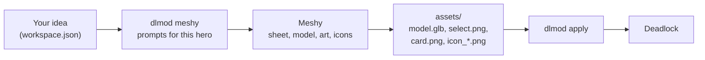

# Custom characters

Put your own character in Deadlock in place of a hero: its 3D model, the hero select screen, the cards and portraits, the ability icons, the models its abilities throw, the colours of its effects and its name. The hero keeps its skeleton, animations, hitboxes and abilities, so it plays exactly the same; only what you see changes. Everything is done by [dlmod](dlmod.md), with no Valve tools, Blender or Source 2 Viewer.



## What can be replaced

| Piece | Where you see it | Command | Mod it goes into |
| --- | --- | --- | --- |
| 3D model | Everywhere in a match | `dlmod model haze model.glb`, or the model studio | *Custom model: Haze* |
| Hero select screen | Picking a hero: the big picture, name, three tags | `dlmod select haze bg=art.png name=SHADE tags=Sneaky,Swift,Deadly colors=#7A3CFF,#FFB020 scene=hide` | *Hero select* (name and tags: *Custom text*) |
| Cards and portraits | Hero select grid, scoreboard, HUD, minimap | `dlmod image panorama/images/heroes/haze_card_psd.vtex_c card.png` | *Custom images* |
| Ability icons | The ability bar | `dlmod icons haze 1=dagger.png` | *Custom images* |
| Ability models | Thrown bombs, placed traps, statues | `dlmod prop models/abilities/ivy_thornbomb_model.vmdl bomb.glb` | *Custom prop: …* |
| Ability effects | Particles, glows, trails | `dlmod paint haze` or `dlmod effects haze #7A3CFF` | *Custom effects* |
| Wording | Hero name and any line of hero text | `dlmod text hero_haze:n=Shade` | *Custom text* |

Each kind of piece goes into one mod, which dlmod rebuilds after every change, so switching a piece off or back on is one line in `dlmod list`. `dlmod select haze restore` and `dlmod effects haze restore` undo theirs.

## The character creator

The studio's **Create** tab (`dlmod studio`) does the whole thing from one page, with [Meshy](https://www.meshy.ai) doing the drawing and modelling:

1. **Meshy key.** Paste your API key from meshy.ai → Settings → API once. It stays in `game/dlmod/meshy/key` and is sent only to Meshy (or set `MESHY_API_KEY`).
2. **Describe your character.** Answer a few questions: its name, what it is (human, creature, robot, alien…), its body (arms and legs, round with no legs, four legs), its style, three colours, what it holds, anything else, and its three tags. dlmod writes the prompts for the picked hero from your answers and the hero's role, weapon and abilities; the description they use can be edited freely.
3. **Make it, step by step.** Each step shows its price and asks before spending credits: the design sheet, then views from the front, side and back, then the 3D model (several views with `meshy-7.1`, or the front view with smart topology), then an optional Meshy rig for characters with arms and legs. While Meshy works, each result shows its place in Meshy's queue and a progress bar; finished pictures appear on the page. The first result of a step is kept; click another to keep that one instead, or make another.
4. **Rig it on the hero.** *Open the model on the Model tab* loads the kept model, fits it to the hero and rigs it on the hero's bones right away, then plays the walk so you can check it. *Install on hero* puts it in the game.
5. **Pictures.** The hero select art, the cards and portraits and one icon per ability are made from the design sheet the same way. *Install pictures* installs the kept ones with your name, tags and colours: the hero select screen (with the 3D scene hidden), the cards (green keyed out) and the icons (as white glyphs).

Everything is saved in `game/dlmod/characters/<hero>`: the answers, every result, and the hero's workspace files, so closing dlmod loses nothing and `dlmod apply` can install the same folder.

dlmod built with `go build -tags nomeshy` leaves the creator out; the Create tab then does not appear. The creator is meant to become a separate download later.

## Checking abilities without the game

The studio's **Abilities** tab shows the picked hero's four abilities the way the game will show them with the mods that are switched on, so a change can be checked without starting Deadlock:

- the ability's name, line and description, and its values (cast range, duration, radius…) from the game's data;
- its icon, the game's own next to the one in game now, with the mod it comes from;
- the colours of its particle effects, before and after, when a mod such as *Custom effects* replaces them;
- the models it throws or places, drawn from any side, next to the model a *Custom prop* mod puts in their place;
- the sound events it plays.

dlmod reads the installed mods the way the game does: when two switched-on mods replace one file, the one in the lower slot wins. *Read the mods again* refreshes the tab after installing or switching mods. Values an ability takes from its base class, such as some cooldowns, are not listed.

## The Meshy workspace

[`meshy/`](../meshy/) has a folder for every hero (44 for build 6864) with everything needed to make a replacement with [Meshy](https://www.meshy.ai):

- **`prompts.md`**: the prompts, in order, written for that hero. They start from a design sheet; every later picture uses the sheet as its reference, so the character stays the same everywhere. The icon prompts describe each of the hero's four abilities from the game's own text, and the 3D prop prompts name the ability models the hero throws. Each step gives the Meshy tool, model, aspect ratio and cost (about 150 credits for a whole hero), the file name to save it as, and the game file it replaces with its size.
- **`README.md`**: the hero's game files (model, skeleton, clips, pictures, icons, name logo, hero select scene, ability models, effects, text keys) and what the game does to its animations.
- **`workspace.json`**: your character's description (`concept`), and the name, tags and tag colours for the hero select screen.
- **`assets/`**: where the generated files go. Git ignores them.

```powershell
dlmod meshy haze meshy concept="Rook, a hulking stone golem with glowing blue runes"
dlmod apply meshy/haze
```

The first line fills the description into the prompts. After generating, the second installs every file that is in `assets/`: the model, the hero select screen, the cards (a flat green background is keyed out), the icons (turned into white glyphs) and the ability models. `dlmod meshy all meshy` writes every hero's folder again from the installed game, after a game update for example.

The abilities' slots, icons and models come from the game's own `scripts/heroes.vdata` and `scripts/abilities.vdata`, which dlmod decodes (they are KeyValues3 compressed with Zstandard). If those cannot be read, for example after the game changes their layout, [`tools/dlmod/hero_abilities.go`](../tools/dlmod/hero_abilities.go) still has them for build 6864, generated with `go run ./internal/genabilities <build>` from deadlock-api's copy of the game data.

## The model studio

Drop a `.glb`, `.gltf` or `.obj` file onto `dlmod.exe`, or run `dlmod studio`. The model studio opens in your browser (it runs on your computer only):

1. **Hero**: pick the hero the model replaces. dlmod reads the hero's model from the game.
2. **Model**: drop the model with its textures (`.png` or `.jpg`), `.mtl` or `.bin` files, or a `.zip` of them. The preview shows it over the hero.
3. **Fit**: the model is scaled to the hero's height and stands on the hero's spot. Size, turn and offset sliders adjust it; *Z is up* is for `.obj` files exported Z-up.
4. **Hero parts**: ticked parts stay (the gun by default); the rest are replaced.
5. **Rig**: *Rig and check* gives every vertex the hero's bones; *Arms up*, *Arms down* and *Legs apart* bend the result to check it. Under *Advanced rig*, *Play the game's clip* plays any of the hero's own animation clips on your model. Melee, reloads and casts are laid over a movement clip through the bone mask the game uses for them (picked by the clip's name, and changeable), and the arms reach for the gun and the feet for the ground by two-bone IK, as the hero graph does. The game blends more layers than this, so the preview is close rather than exact.
6. **Install**: builds the mod *Custom model: <hero>* and installs it. Importing again replaces it.

**Checking the rig against the game.** After rigging, *Check against the game's clips* plays the hero's run, idle, a melee and a reload laid over the movement, a cast and a jump on your model, the way the game plays them, and measures how much of its surface stretches or squashes to 1.6 times its length or more. Each clip shows your model next to the hero's own body, which strains a little too, so only what your rig adds counts. It also tells when parts sink into the ground or swing behind the hero, where the third-person camera sits. Three tuning options answer what the game does to a hero's bones:

- **Steady body**: the body follows the hips only, not the spine's lean and twist. For a round or rigid body; a humanoid body usually needs its spine.
- **Arms without IK**: the arms follow the shoulders instead of being pulled to the gun every frame. For arms that hold something else, or none.
- **Bind the body in the usual pose**: the hero leans while moving (Haze by 40°); a model made standing upright is bound in that lean, so it stays upright in play.

The check tries the first two options on your model and suggests one only when it lowers the stretching, with the numbers; the third it suggests when the hero leans more than 12°.


*Rig and check* then *Arms up*: the model lifts its arms with the guns in its hands, while Wraith's ghost stays in its bind pose. dlmod matched the model's pose first (Wraith's arms 24° lower, legs 10° wider) and copied the weights from Wraith's body.


Without the browser: `dlmod model wraith model.glb`, with `-keep gun,cards` (parts to keep), `-scale 1.05`, `-yaw 90` or `-zup`. `-keep none` drops the hero's own gun, and `-move muzzle_flash=X,Y,Z` moves where shots and muzzle flashes start, for a character that holds something else. `-steady`, `-no-arm-ik` and `-usual-pose` are the rig tuning options below.

How it works:

- **Rigging.** A rigged model (a `.glb` or `.gltf` with a skin) keeps its own weights. Each of its joints is mapped to the hero bone it stands for, by the shape of the skeleton, so a Meshy rig with fingers and twist bones lands on the right bones. Weapons follow the joint they hang from. A model without a rig (any `.obj`) copies weights from the hero's own body, point by point. Clothes, hair and capes of the hero are left out, so the new model does not flap like them.
- **Pose.** If the model stands in another pose than the hero (arms down, or a T-pose), dlmod first bends the hero's arms and legs to match, copies the weights, then bends the model back into the hero's pose.
- **Pieces.** Small loose pieces that reach from a hand to a leg, such as a gun held at the hip, follow the hand as one piece. Weights are smoothed across the surface so joints bend without seams.
- **Materials.** Each material of the model becomes a material for Deadlock's hero shader (`pbr.vfx`, with its outlines and status effects), and its colour texture is compressed to BC1 or BC3. WebP textures are not read: export with PNG or JPEG.
- **Files.** dlmod rewrites the hero's `.vmdl_c` around the new mesh. Its blocks are decoded and written as [ValveResourceFormat](https://github.com/ValveResourceFormat/ValveResourceFormat) reads them: binary KeyValues3 (versions 4 and 5), meshoptimizer-compressed vertex and index buffers, the external reference list. Everything but the mesh blocks is copied unchanged.

## What we found out about Deadlock

Making a character that is nothing like the hero it replaces taught us how the game treats a hero. dlmod takes care of the turned `root_motion`, the muzzle bones, the hero select scene, the name logo and the tag colours; the animation notes matter when you rig a character by hand, and each hero's workspace README repeats them with that hero's bones and masks.

**Animations**

- **Any model plays the hero's clips.** The game never asks what the model looks like: it plays the hero's own animation clips (Ivy has 160) on the hero's skeleton, and the model follows the bones it is weighted to. dlmod reads these clips (AnimGraph2 `.vnmclip`) to test a rig against the poses the game really plays.
- **Melee and reloads are only half the body.** They are laid over the walking or standing pose through bone masks stored in the skeleton (`melee_UpperBody` gives the arms and head the melee clip fully and the spine 5%, 36% and 70% of it; the hips and legs keep walking). A rig checked against the whole melee clip moves differently in game.
- **Arms and legs are solved by IK.** Every frame the hero graph pulls both hands to the gun (`weaponHand_L`, `weaponHand_R`) and the feet to their targets (`leg_*_IKTARGET`), so arm bones in game are not where the clips put them. Parts that must follow the hero reliably use the head, neck, spine, clavicles, pelvis and the leg targets.
- **Some bones never move.** `attachWorld` stays put and is a steady anchor. `root_motion` is the character's place on the ground, but its rest pose in the model file is turned on its side, so vertices weighted to it lie down unless they are turned back, which dlmod does.
- **Bind to the hero's usual pose.** A body bound to the hero's T-pose leans with every step of a hero who walks bent forward; bound to the hero's average pose over its clips, it stays upright.
- **The camera sits close behind.** A wide character hides whatever its arms do in front of it, and moving the body backwards puts the camera inside it.

**Weapons**

- `muzzle_flash` and `muzzle_fx` are not animated: the game places them from the model's rest pose, so moving them at rest (`-move`) makes shots start from whatever the character holds.

**Hero select screen**

- The big hero on the hero select screen is a live 3D scene: a small map per hero, `maps/ui/hero_prefabs/<hero>.vpk`, with the hero model, props, lights and a camera. Mods ship it as a file inside their VPK. `scene=hide` shrinks its props and world meshes away so the background picture shows on its own.
- The background is `panorama/images/heroes/backgrounds/<hero>_bg_psd` (4096x2312); its left side sits under the hero grid.
- The name is an SVG (`panorama/images/heroes/hero_names/<hero>.vsvg_c`): white filled paths after a CRC32 of the text. dlmod draws names with a small stroke font, or takes your SVG.
- The three tags are lines of hero text, and their colours come from one stylesheet for all heroes (`citadel_hero_tags.vcss_c`, rules like `.hero_tengu … .heroTag.Tag1 .tagBacker`).

**Pictures and props**

- Ability icons are white glyphs on transparency (137x137) that the HUD tints. Cards are 280x380, the tall portrait 120x200, the minimap icon 50x50.
- Which icon belongs to which ability is not in the icon's name (Ivy's *Air Drop* is `tengu_lightning_crash`); it is in `scripts/abilities.vdata` (`m_strAbilityImage`), with the particles, models, sounds and values of each ability; the hero's four slots are in `scripts/heroes.vdata` (`m_mapBoundAbilities`). Both are KeyValues3 compressed with Zstandard, which dlmod decodes itself.
- Older ability models (thrown bombs) use the older model layout with an `MBUF` block; dlmod reads and rewrites both layouts.
